# 🧪 VectorLab — Transparent Vector Search & Deterministic K-Means Playground

<p align="center">
  <strong>See what vector similarity really means. Deconstruct cosine scores into exact contributions, expose hash collision artefacts, and trace deterministic k-means clustering with mathematical precision.</strong>
</p>

<p align="center">
  <a href="https://github.com/serviceprovidermanchester/SPM-Aidev-VectorLab-Agent/actions"></a>
  <a href="https://nodejs.org/"></a>
  <a href="https://www.sqlite.org/"></a>
  <a href="#zero-dependencies"></a>
  <a href="LICENSE"></a>
  <a href="https://www.spmanchester.com"></a>
</p>

> **Built with ❤️ by [SPManchester Private Limited](https://www.spmanchester.com)** — Enterprise Web, App, AI & Cloud Engineering Solutions.  
> **Lead Architect & Maintainer:** Sayed Mudassar Akbar ([info@spmanchester.com](mailto:info@spmanchester.com))

---

## 📑 Table of Contents

- [Executive Summary](#-executive-summary)
- [The Problem VectorLab Solves](#-the-problem-vectorlab-solves)
- [Core Architecture & Flowchart](#-core-architecture--flowchart)
- [Algorithmic Rigor & Mathematical Foundations](#-algorithmic-rigor--mathematical-foundations)
  - [1. Tokenisation Pipeline](#1-tokenisation-pipeline)
  - [2. Smoothed TF-IDF Vectoriser](#2-smoothed-tf-idf-vectoriser)
  - [3. 64-Bucket Hashed Bag-of-Words Vectoriser](#3-64-bucket-hashed-bag-of-words-vectoriser)
  - [4. Explainable Cosine Similarity](#4-explainable-cosine-similarity)
  - [5. Deterministic Lloyd K-Means Clustering](#5-deterministic-lloyd-k-means-clustering)
  - [6. Quantitative Cluster Quality Metrics](#6-quantitative-cluster-quality-metrics)
- [Visual Tour & Screen Gallery](#-visual-tour--screen-gallery)
- [Key Enterprise Features](#-key-enterprise-features)
- [Technology Stack](#-technology-stack)
- [Step-by-Step Installation & Quickstart](#-step-by-step-installation--quickstart)
  - [Native Execution (Zero Dependencies)](#native-execution-zero-dependencies)
  - [Containerized Deployment (Docker & Compose)](#containerized-deployment-docker--compose)
- [API Reference (28 Endpoints)](#-api-reference-28-endpoints)
- [Practical Usage & Terminal Examples](#-practical-usage--terminal-examples)
- [Verification & Automated Test Suite](#-verification--automated-test-suite)
- [Enterprise Production Roadmap](#-enterprise-production-roadmap)
- [Contributing & Governance](#-contributing--governance)
- [About SPManchester Private Limited](#-about-spmanchester-private-limited)

---

## 🔍 Executive Summary

Modern machine learning and search engineering teams frequently adopt black-box embedding providers and hosted vector databases without intuitive understanding of how text representations behave in practice. Similarity scores appear as arbitrary floating-point numbers, clustering runs are evaluated by subjective inspection, and subtle representation defects—such as vocabulary out-of-bounds drops, frequency distortions, and hash collisions—remain hidden until production retrieval degrades.

**VectorLab** is a self-contained, offline-first vector search and clustering laboratory. It allows engineers, data scientists, and technical leaders to:
- Compare **exact TF-IDF vectors** against **fixed-dimension hashed bag-of-words vectors**.
- Inspect cosine similarity scores broken down into the **exact per-term and per-bucket contributions** that sum to the final metric.
- Run **strictly deterministic k-means clustering** with monotonically non-increasing inertia curves, silhouette quality checks, and ground-truth topic purity validation.
- Audit the mathematics by hand against an included 9-document verifiable test fixture.

Built entirely with standard Node.js built-ins (`node:http`, `node:sqlite`, `node:crypto`), VectorLab requires **zero external npm packages**, runs instantaneously anywhere Node 22.5+ is installed, and provides a full-featured single-page management console alongside a comprehensive 28-endpoint REST API.

---

## 🎯 The Problem VectorLab Solves

| Challenge in Modern Vector Search | How VectorLab Resolves It |
| :--- | :--- |
| **Black-box Similarity:** Dense embedding vectors produce cosine scores (e.g., `0.784`) with zero insight into why document A scored higher than document B. | **Deconstructive Explanations:** Every search hit outputs an ordered contribution matrix ($q_i \cdot d_i$) proving precisely which terms or hash buckets created the score. |
| **Silent Representation Artefacts:** Hashed and dimensionality-reduced embeddings experience bucket collisions that induce false semantic associations. | **Collision Transparency:** VectorLab’s 64-bucket FNV-1a vectoriser explicitly reports multi-token collisions (e.g. showing how fitness and dental terms land in bucket 36). |
| **Stochastic Clustering:** Standard k-means implementations rely on random centroid initialization, producing varying clusters and non-reproducible runs. | **Deterministic Lloyd Iteration:** Centroids seed deterministically from the first $k$ documents, recording a guaranteed non-increasing inertia trace across iterations. |
| **Heavy Tooling Bloat:** Most vector evaluation tools require extensive Python virtual environments, GPU drivers, and gigabytes of dependencies. | **Zero-Dependency Native Execution:** Pure Node.js 22.5+ with built-in SQLite, booting in milliseconds with zero supply-chain risk. |

---

## 🏗️ Core Architecture & Flowchart

VectorLab is architected as a layered, modular engine separating mathematical vectorisation from persistent storage and transport:

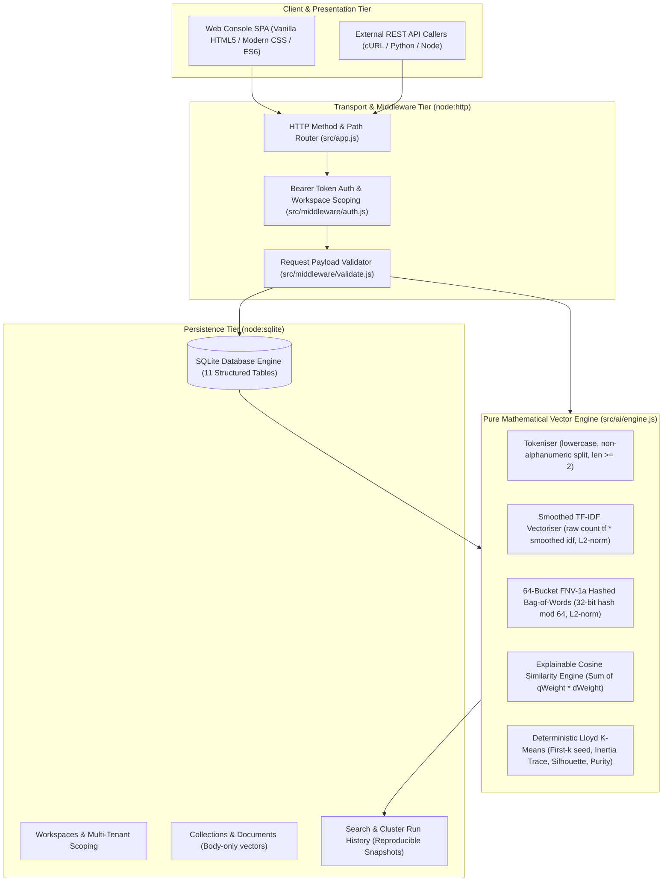

---

## 🧮 Algorithmic Rigor & Mathematical Foundations

### 1. Tokenisation Pipeline
- Normalisation: Unicode lowercase transformation.
- Delimiter: Splits across any sequence of non-alphanumeric characters (`[^a-z0-9]+`).
- Filtering: Retains tokens with character length $\ge 2$.
- Scope: Built **strictly from document body text**. Titles and topic annotations remain metadata and never contaminate vectors.

### 2. Smoothed TF-IDF Vectoriser
Given a collection of $N$ documents where document frequency $df(t)$ represents the count of documents containing term $t$:

$$\text{idf}(t) = \ln\left(\frac{1 + N}{1 + df(t)}\right) + 1$$

$$\text{weight}(t, d) = \text{count}(t, d) \times \text{idf}(t)$$

$$\mathbf{v}_{\text{tfidf}}(d) = \frac{\mathbf{w}(d)}{\|\mathbf{w}(d)\|_2}$$

- **Smooth Guarantee:** A term present in every document ($df = N$) retains an IDF of exactly $1.0$. No term drops to zero weight.
- **Out of Vocabulary:** Missing query terms are captured in `outOfVocabulary` and omitted from calculations.

### 3. 64-Bucket Hashed Bag-of-Words Vectoriser
Tokens are hashed using 32-bit FNV-1a:
- Offset basis: $2166136261$
- Prime: $16777619$
- Bucket assignment: $b = \text{hash}(t) \pmod{64}$

$$\mathbf{v}_{\text{hash}}(d) = \frac{\mathbf{c}(d)}{\|\mathbf{c}(d)\|_2}$$

Because collisions occur naturally in fixed dimensions, VectorLab preserves complete auditability: explanations display the exact set of tokens that collided in each bucket.

### 4. Explainable Cosine Similarity
Between query vector $\mathbf{q}$ and document vector $\mathbf{d}$:

$$\text{Cosine}(\mathbf{q}, \mathbf{d}) = \mathbf{q} \cdot \mathbf{d} = \sum_{i} q_i \cdot d_i$$

Every query response returns ranked components sorted by individual contribution $q_i \cdot d_i$, and the contributions sum exactly to the reported cosine similarity score.

### 5. Deterministic Lloyd K-Means Clustering
- **Initialization:** Centroids are initialized to the vectors of the **first $k$ stored documents** ($id$ ascending). No pseudo-random generators are used.
- **Assignment:** Each document is assigned to the nearest centroid by Euclidean distance. Ties default to the lowest cluster index.
- **Inertia Guarantee:**

$$\text{Inertia} = \sum_{j=1}^{k} \sum_{x \in C_j} \|x - \mu_j\|^2$$

Centroids update to the unnormalized arithmetic mean of member vectors. Centroids are deliberately **not renormalised** after updating, ensuring that the iteration inertia trace is monotonically non-increasing.

### 6. Quantitative Cluster Quality Metrics
- **Silhouette Coefficient:** For document $i$ in cluster $A$:
  $$a(i) = \frac{1}{|A|-1} \sum_{j \in A, j \neq i} \|x_i - x_j\|_2, \quad b(i) = \min_{C \neq A} \frac{1}{|C|} \sum_{j \in C} \|x_i - x_j\|_2$$
  $$s(i) = \frac{b(i) - a(i)}{\max(a(i), b(i))}$$
  Reported score is the global mean $\bar{s}$. Singleton clusters score $0$.
- **Topic Purity:** When ground-truth topic labels are present:
  $$\text{Purity} = \frac{1}{N} \sum_{j=1}^{k} \max_{\ell} |C_j \cap L_\ell|$$

---

## 📸 Visual Tour & Screen Gallery

VectorLab includes 10 fully interactive console views served directly by the backend:

| View | Description | Screenshot Preview |
| :--- | :--- | :--- |
| **01. Dashboard** | Real-time workspace analytics, latest cluster purity banner, activity logs | [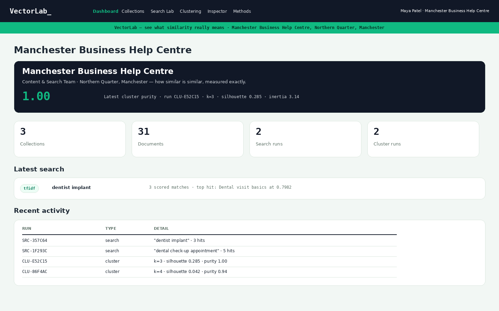](screenshots/01-dashboard.png) |
| **02. Collections** | Document collection management, topic distributions, and creation wizards | [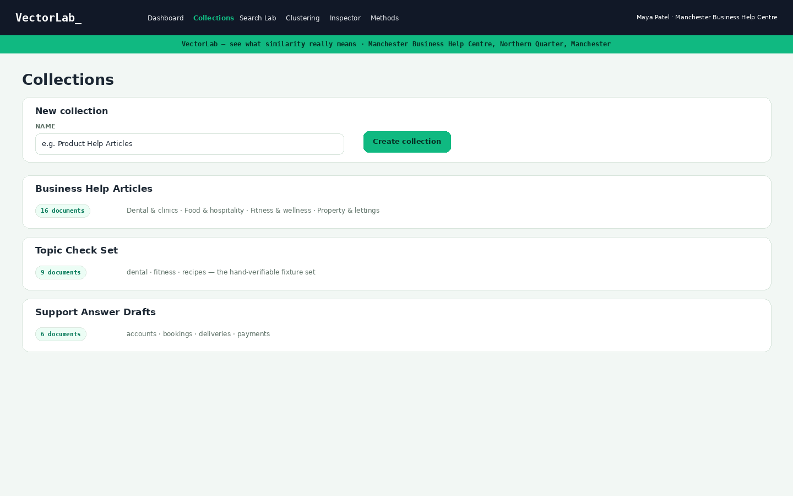](screenshots/02-collections.png) |
| **03. Collection Detail** | Document inventory with topic badges, word counts, and search indexing | [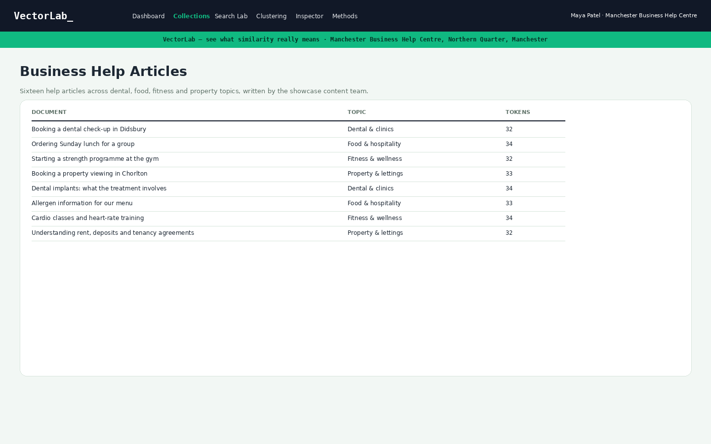](screenshots/03-collection-detail.png) |
| **04. Document Detail** | Side-by-side comparison of TF-IDF terms vs 64-bucket hashed vector weights | [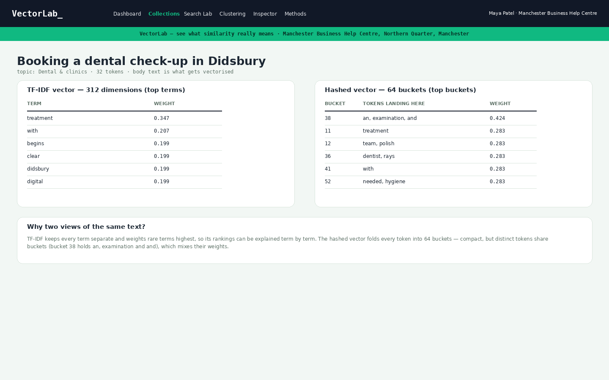](screenshots/04-document-detail.png) |
| **05. Search Lab** | Interactive query runner with vectoriser toggle and parameter controls | [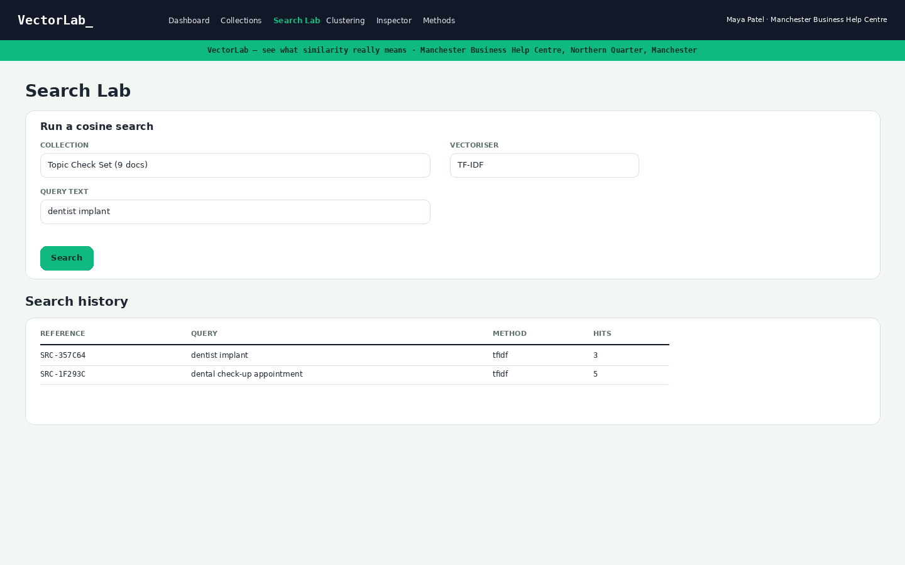](screenshots/05-search-lab.png) |
| **06. Search Results** | Ranked hits with visual score gauges and granular contribution breakdowns | [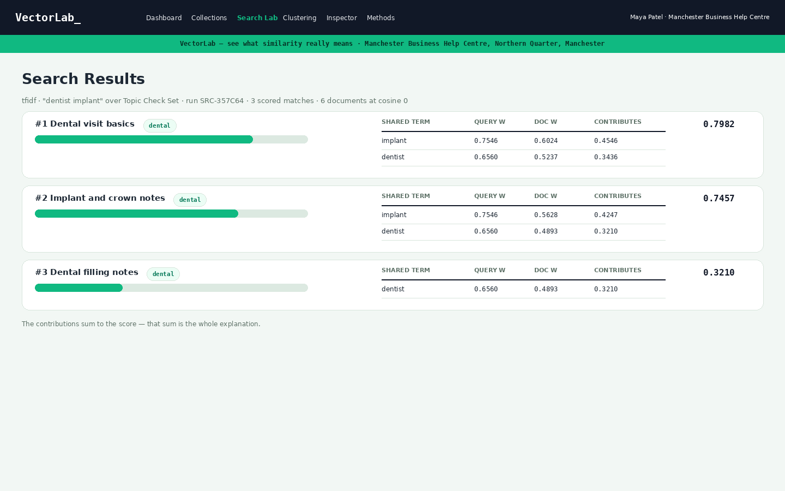](screenshots/06-search-results.png) |
| **07. Clustering Lab** | K-means parameter configuration, iteration budgets, and execution history | [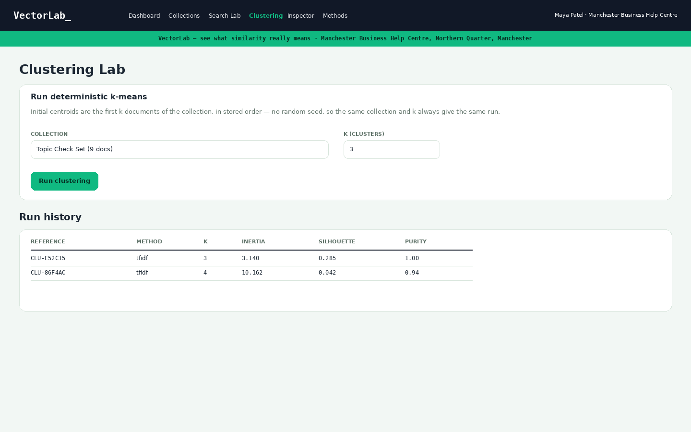](screenshots/07-clustering-lab.png) |
| **08. Cluster Detail** | Non-increasing inertia curves, silhouette scores, purity, and member distances | [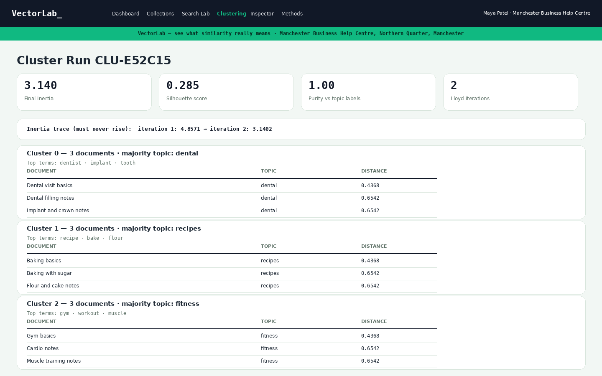](screenshots/08-cluster-detail.png) |
| **09. Vector Inspector** | Pairwise document similarity comparison with shared-term inspection | [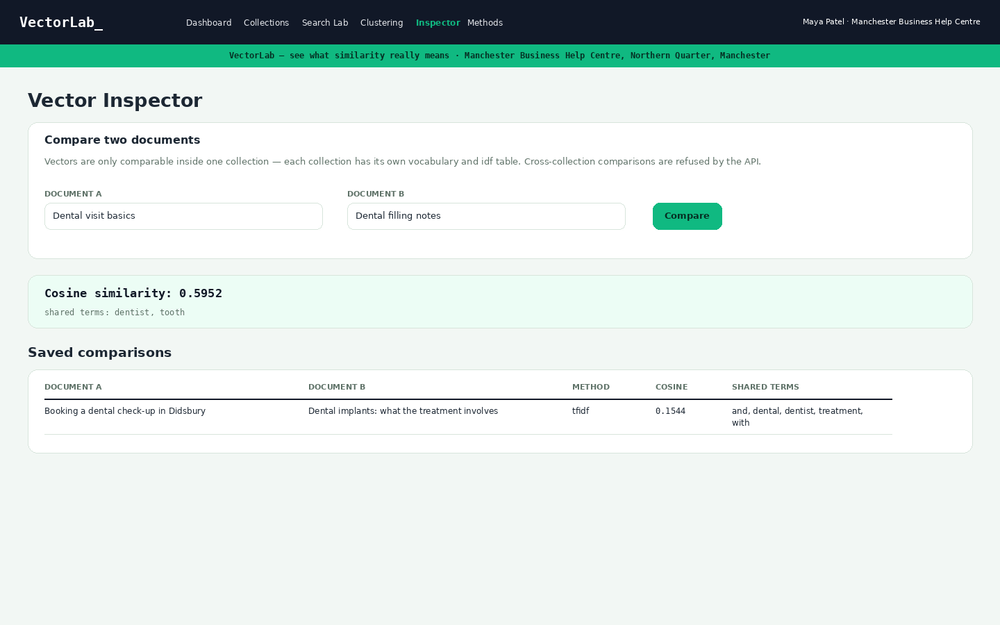](screenshots/09-vector-inspector.png) |
| **10. Methods & Help** | Live collection vocabulary explorer (DF, IDF, buckets) and technical documentation | [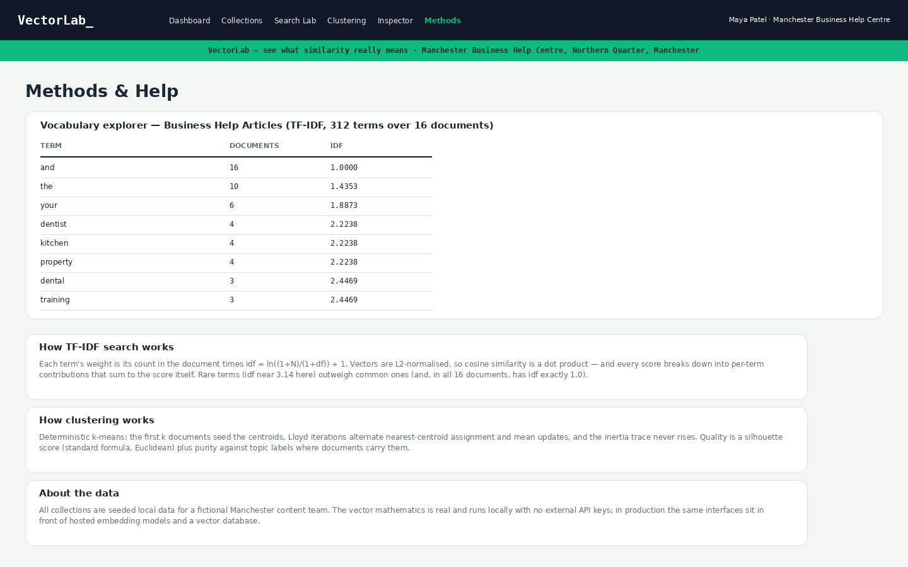](screenshots/10-methods-help.png) |

---

## ⚡ Key Enterprise Features

- **Dual Deterministic Vectorisers:** Switch effortlessly between smoothed TF-IDF and 64-bucket FNV-1a hashed bag-of-words per query.
- **Complete Mathematical Explainability:** Understand every score down to the contribution of individual words or hash buckets.
- **Immutable Run History:** Every search, clustering run, and document comparison is stored with its parameters and results for reproducible audits.
- **Multi-Tenant Workspace Scoping:** Role-based access control (RBAC) separates Owner from Staff accounts, isolating workspace data with strict scoping.
- **Zero Supply-Chain Footprint:** Built exclusively on standard Node.js built-ins (`node:http`, `node:sqlite`, `node:crypto`).
- **Production-Ready Containerization:** Includes automated Dockerfile and docker-compose configurations with health checks and volume persistence.

---

## 🛠️ Technology Stack

- **Runtime:** Node.js (v22.5.0+)
- **HTTP Server:** Native `node:http` (custom zero-overhead router)
- **Database Engine:** Native `node:sqlite` (SQLite 3 with prepared statements)
- **Cryptography:** Native `node:crypto` (`scrypt` password hashing, CSPRNG tokens)
- **Frontend Architecture:** Vanilla JavaScript (ES6+), semantic HTML5, modern CSS variables
- **Testing:** Custom test harness with 42 automated end-to-end integration checks

---

## 🚀 Step-by-Step Installation & Quickstart

### Prerequisites
- Node.js 22.5.0 or later installed on your system.

### Native Execution (Zero Dependencies)

```bash
# 1. Clone the repository
git clone https://github.com/serviceprovidermanchester/SPM-Aidev-VectorLab-Agent.git
cd SPM-Aidev-VectorLab-Agent

# 2. Syntax check
npm run check

# 3. Launch the server (console at http://localhost:4000)
npm start

# 4. In a separate terminal, execute the 42-check verification suite
npm test
```

### Containerized Deployment (Docker & Compose)

Deploy VectorLab with persistent storage using Docker:

```bash
# Build and run using Docker Compose
docker compose up -d

# Verify container status and healthcheck
docker compose ps

# Access the web console at http://localhost:4000
```

### Pre-Seeded Demonstration Accounts

| Role | Email Address | Password | Permissions |
| :--- | :--- | :--- | :--- |
| **Owner** | `owner@manchesterbusinesshelp.co.uk` | `Owner2026!` | Full workspace administration, collection edits, run deletion |
| **Staff** | `team@manchesterbusinesshelp.co.uk` | `Team2026!` | Search, cluster, compare, and vocabulary exploration |

---

## 📡 API Reference (28 Endpoints)

All endpoints reside under `/api/v1` and communicate via JSON:

| Method | Endpoint | Authentication | Purpose |
| :--- | :--- | :--- | :--- |
| `GET` | `/health` | Public | System health check and seeded document counters |
| `POST` | `/api/v1/auth/register` | Public | Register owner account & provision workspace |
| `POST` | `/api/v1/auth/login` | Public | Sign in and receive 30-day session token |
| `POST` | `/api/v1/auth/logout` | Authenticated | Invalidate active session token |
| `GET` | `/api/v1/auth/me` | Authenticated | Retrieve current user profile |
| `PUT` | `/api/v1/auth/me` | Authenticated | Update user name and telephone |
| `GET` | `/api/v1/workspace` | Authenticated | Get current workspace profile and lab settings |
| `PUT` | `/api/v1/workspace` | Owner Only | Update workspace profile and default parameters |
| `GET` | `/api/v1/collections` | Authenticated | List collections with document & topic counts |
| `POST` | `/api/v1/collections` | Authenticated | Create a new document collection |
| `GET` | `/api/v1/collections/:id` | Authenticated | Get single collection metadata and documents |
| `DELETE` | `/api/v1/collections/:id` | Owner Only | Delete collection and its associated documents |
| `GET` | `/api/v1/documents` | Authenticated | Query documents (`?collectionId=&q=`) |
| `POST` | `/api/v1/documents` | Authenticated | Add a new document to a collection |
| `GET` | `/api/v1/documents/:id` | Authenticated | Inspect single document's dual vector breakdown |
| `DELETE` | `/api/v1/documents/:id` | Owner Only | Delete individual document |
| `POST` | `/api/v1/search` | Authenticated | Execute explainable cosine search and store run |
| `GET` | `/api/v1/searches` | Authenticated | List historical search runs for workspace |
| `GET` | `/api/v1/searches/:id` | Authenticated | Retrieve full search run with contribution breakdown |
| `POST` | `/api/v1/compare` | Authenticated | Compare two documents in the same collection |
| `GET` | `/api/v1/compare` | Authenticated | List saved pairwise comparisons |
| `POST` | `/api/v1/clusters` | Authenticated | Run deterministic k-means and save assignments |
| `GET` | `/api/v1/clusters` | Authenticated | List historical clustering runs |
| `GET` | `/api/v1/clusters/:id` | Authenticated | Retrieve cluster details, inertia trace, assignments |
| `GET` | `/api/v1/vocabulary` | Authenticated | Explore collection vocabulary (DF/IDF or buckets) |
| `GET` | `/api/v1/dashboard` | Authenticated | Workspace overview, metrics, and activity stream |
| `GET` | `/api/v1/notifications` | Authenticated | Retrieve user notifications |
| `PATCH` | `/api/v1/notifications/read` | Authenticated | Mark notifications as read |

---

## 💻 Practical Usage & Terminal Examples

### 1. Authenticate and Obtain Bearer Token
```bash
TOKEN=$(curl -s -X POST http://localhost:4000/api/v1/auth/login \
  -H "Content-Type: application/json" \
  -d '{"email":"owner@manchesterbusinesshelp.co.uk","password":"Owner2026!"}' \
  | node -e "fs=require('fs'); console.log(JSON.parse(fs.readFileSync(0)).data.token)")
```

### 2. Execute an Explainable TF-IDF Cosine Search
```bash
curl -X POST http://localhost:4000/api/v1/search \
  -H "Authorization: Bearer $TOKEN" \
  -H "Content-Type: application/json" \
  -d '{
    "collectionId": 1,
    "query": "dental implant treatment",
    "method": "tfidf",
    "topK": 3
  }'
```

### 3. Run Deterministic K-Means Clustering
```bash
curl -X POST http://localhost:4000/api/v1/clusters \
  -H "Authorization: Bearer $TOKEN" \
  -H "Content-Type: application/json" \
  -d '{
    "collectionId": 1,
    "method": "tfidf",
    "k": 4
  }'
```

### 4. Inspect Collection Vocabulary & IDF Distribution
```bash
curl "http://localhost:4000/api/v1/vocabulary?collectionId=1&method=tfidf" \
  -H "Authorization: Bearer $TOKEN"
```

---

## 🧪 Verification & Automated Test Suite

VectorLab includes an automated test harness in `tests/run-tests.js` executing 42 live checks against a temporary database:

```bash
node tests/run-tests.js
```

### Mathematical Benchmark Fixture (VL-01 through VL-14)
Built upon a 9-document hand-verifiable fixture set (three distinct topics: dental, recipes, fitness), the suite verifies:
- **VL-01:** Exact smoothed IDF values ($N=9$, $df=3 \implies \ln(10/4)+1 = 1.916291$).
- **VL-02 & VL-03:** "dentist implant" top ranking at $0.798218$ with component terms reconciling to the final score ($0.454571 + 0.343647$).
- **VL-04 & VL-05:** Orthogonal document pairs score exactly $0.0$; identical documents score exactly $1.0$.
- **VL-07:** Hash collision transparency: workout and dentist both mapping to bucket 36, causing cross-topic scoring of $0.408248$.
- **VL-10 & VL-11:** K-means recovering 100% topic purity ($1.0$), with non-increasing inertia traces ($4.857128 \to 3.140236$).

---

## 🗺️ Enterprise Production Roadmap

- [ ] **Hosted Model Adapters:** Support pluggable vectorisation adapters for OpenAI (`text-embedding-3`), Google Gemini (`text-embedding-004`), Anthropic Voyage, and HuggingFace models.
- [ ] **Vector Database Indexing:** Connect search pipelines to pgvector, Pinecone, Qdrant, and Weaviate.
- [ ] **Interactive Dimensionality Reduction:** Embed 2D PCA and UMAP coordinate visualisations inside the Cluster Detail console view.
- [ ] **Document Chunking Pipelines:** Configurable sliding-window token chunking for long-form document indexing.

---

## 🤝 Contributing & Governance

Contributions are warmly welcomed! Please read our [Contributing Guide](CONTRIBUTING.md) and [Code of Conduct](CODE_OF_CONDUCT.md) before opening pull requests.

For security reports, please refer to our [Security Policy](SECURITY.md).

---

## 🏢 About SPManchester Private Limited

**[SPManchester Private Limited](https://www.spmanchester.com)** is a software engineering and technology consulting company headquartered in Manchester, United Kingdom. We build enterprise digital products, intelligent AI platform tooling, cloud infrastructure, and bespoke software solutions for forward-thinking organizations worldwide.

- **Corporate Website:** [https://www.spmanchester.com](https://www.spmanchester.com)
- **Primary Contact:** [info@spmanchester.com](mailto:info@spmanchester.com)
- **Lead Architect:** Sayed Mudassar Akbar
- **GitHub Organization:** [@serviceprovidermanchester](https://github.com/serviceprovidermanchester)
- **Areas of Practice:** AI Engineering & LLMOps, Custom Web & Mobile Application Development, Enterprise Architecture, High-Performance Systems.

---

<p align="center">
  <sub>Copyright © 2026 <strong>SPManchester Private Limited</strong>. All rights reserved.</sub>
</p>
